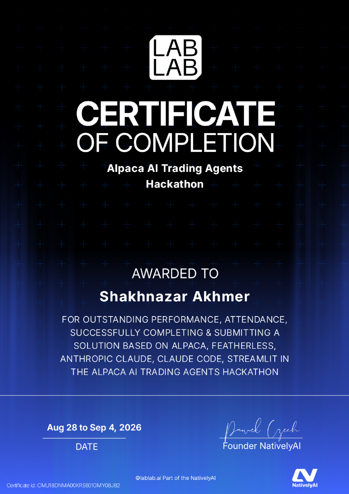

# ThetaDesk: certificates

**Certificate of completion for the Alpaca AI Trading Agents Hackathon**, hosted on lablab.ai, **28 August–4 September 2026**. It names Shakhnazar Akhmer and confirms completion and submission of a solution.

## Alpaca AI Trading Agents Hackathon — completion

[Open the original document](alpaca-hackathon-completion.pdf)

## Document provenance

Supplied by Shakhnazar Akhmer on 12 October 2026. Original documents are preserved byte for byte; PNG previews of PDFs are page renders. Project associations follow the submitted project records and Shakhnazar’s identification of the events.

[File checksums](manifest.json) · [Back to the project](../../README.md)
